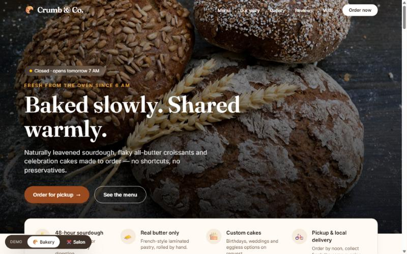
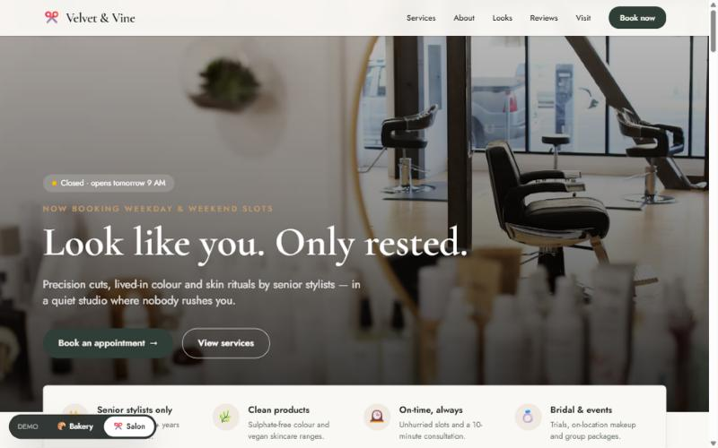
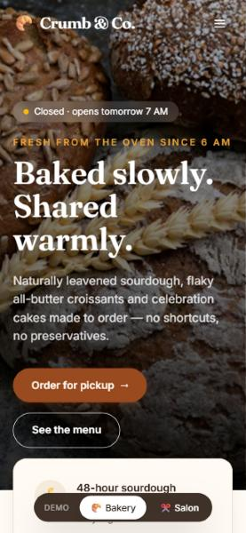
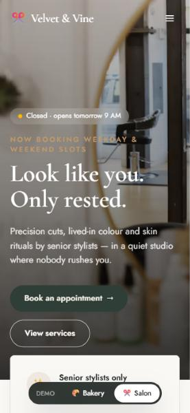

# Small-Business Website - Bakery & Salon Themes

A fast, responsive one-page website for local businesses, built with **React, TypeScript, Vite and Tailwind CSS**.
One codebase ships two complete brands - a **bakery** and a **hair & beauty salon** - and can be re-skinned for a new client by editing a single data file.

**Live demo:** https://raj02priyesh.github.io/bakery-salon-website/
- [bakery](https://raj02priyesh.github.io/bakery-salon-website/?brand=bakery) · [salon](https://raj02priyesh.github.io/bakery-salon-website/?brand=salon) · or use the **Demo** switch at the bottom of the page.

| Bakery - *Crumb & Co.* | Salon - *Velvet & Vine* |
|---|---|
|  |  |

<p align="center">
  
  &nbsp;&nbsp;
  
</p>

## What's on the page

- **Hero** with a live *Open now / Closed · opens tomorrow 7 AM* badge, calculated in the business's own time zone
- **Highlights** strip - why customers should choose this business
- **Menu / services & prices** with category filters, tags, durations and "from" prices
- **Story** section with key numbers
- **Gallery** with a keyboard-accessible lightbox (←, →, Esc)
- **Reviews** and **team** cards
- **Order / booking request form** that checks opening days, opening hours, minimum notice and Indian mobile numbers, shows an estimate, then a summary - and, once a WhatsApp number is configured, opens WhatsApp with the request pre-filled for the business
- **FAQ** accordion, **opening hours** table (today highlighted) and an **OpenStreetMap** embed with directions
- Responsive from 320 px phones to wide desktops, scroll-reveal animations (respecting *reduced motion*), semantic HTML, skip link, focus styles and ARIA labels
- Per-brand page title, meta description, theme colour and favicon

## How the theming works

Every brand is one typed object in [`src/brands/`](src/brands) - copy, colours, fonts, corner radius, menu items, opening hours and contact details.
At runtime the theme is written into CSS variables, and Tailwind's colour and font tokens point at those variables, so **the same components render a cosy bakery or a calm salon**.

To create a site for a new client:

1. Copy `src/brands/bakery.ts` to a new file and edit the content.
2. Register it in `src/brands/index.ts`.
3. Build it as a single-brand site with no demo switch: `VITE_BRAND=bakery npm run build`.
4. Set `contact.whatsapp` to the client's number (e.g. `919876543210`) so the form sends requests straight to them.

## Tech stack

| | |
|---|---|
| UI | React 19, TypeScript |
| Styling | Tailwind CSS v4 with CSS-variable brand tokens |
| Build | Vite |
| Tests | Vitest - booking rules, opening hours, data integrity (24 tests) |
| Lint | oxlint (incl. React rules) |
| CI/CD | GitHub Actions: lint → test → type-check & build → deploy to GitHub Pages |

## Run locally

```bash
npm install
npm run dev        # http://localhost:5173  (?brand=salon for the salon)
npm test           # unit tests
npm run lint
npm run build      # type-check + production build in dist/
```

## Credits

Photos from [Unsplash](https://unsplash.com/license). Both businesses, their staff, reviews, addresses and phone numbers are fictional; the order and booking forms in the demo don't send anything.

## License

[MIT](LICENSE) © Priyesh Raj
